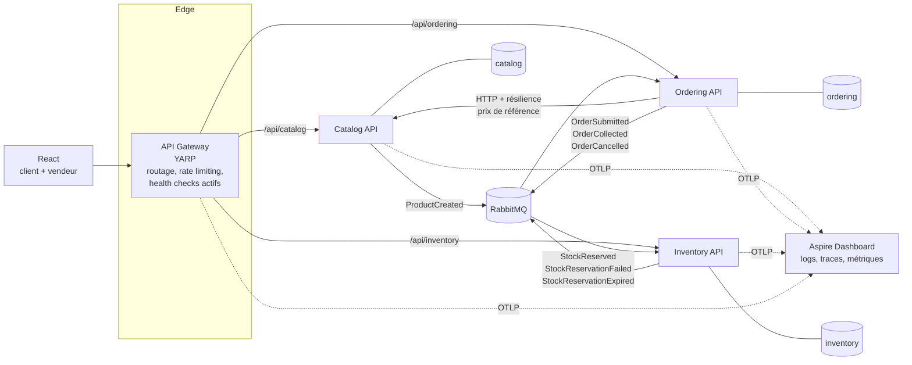
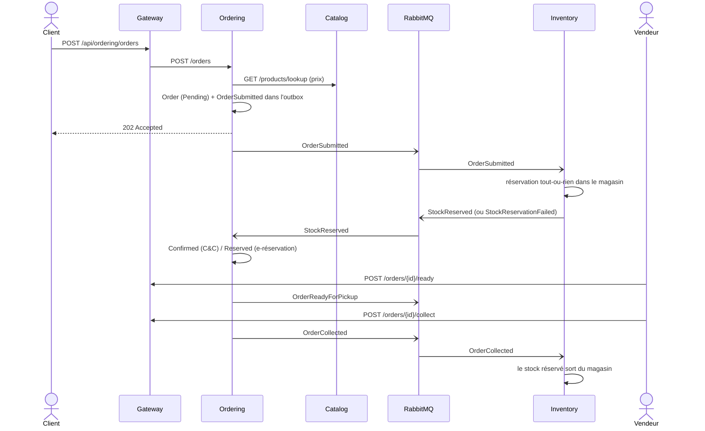
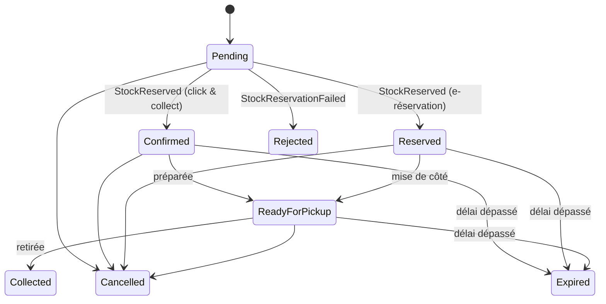

# OmniOrder — Commandes omnicanales en microservices

[](https://github.com/KarnasZiad/OmniOrder/actions/workflows/ci.yml)


OmniOrder met en œuvre les deux parcours phares de la vente omnicanale :

- **Click & collect** : le client paie en ligne, le magasin choisi prépare la commande, le client la retire.
- **Réserver en magasin** (e-réservation) : rien n'est payé en ligne, l'article est mis de côté 48 h et payé au retrait.

Trois services **.NET 8** (Catalogue, Commandes, Stock) communiquent **par messages via RabbitMQ**
(MassTransit) et sont exposés derrière une **API Gateway YARP**. Un front **React** propose un espace
client et un espace vendeur. L'ensemble démarre avec **Docker Compose** : health checks, logs
centralisés et traces distribuées **OpenTelemetry**.

## Architecture



- **Une base par service** (PostgreSQL) : aucun service ne lit la base d'un autre.
- **Communication asynchrone** pour tout ce qui modifie l'état d'un autre service (réservation, retrait, annulation), **synchrone** uniquement pour une lecture de référence (prix du catalogue), protégée par le pipeline de résilience standard (timeout, retries, circuit breaker).
- **Outbox transactionnelle** (MassTransit + EF Core) : l'écriture en base et la publication du message sont atomiques ; un message n'est jamais perdu ni publié pour une transaction annulée.
- **Inbox / idempotence** : un message redélivré n'est pas traité deux fois ; les consumers sont en plus idempotents par conception.

### Parcours click & collect



### Cycle de vie d'une commande



Règles notables :

- La réservation est **tout-ou-rien** : si une seule ligne manque dans le magasin choisi, rien n'est réservé et la commande est refusée (avec la liste des références manquantes).
- Les prix viennent **toujours** du catalogue, jamais du navigateur.
- Paiement : capturé à la commande en click & collect (simulé), remboursé en cas de refus, d'annulation ou d'expiration ; à payer au comptoir pour l'e-réservation.
- **Compensation** : si le client annule avant que la réservation n'arrive, `Ordering` republie `OrderCancelled` à réception du `StockReserved` tardif, et le stock est libéré.
- Concurrence : verrouillage optimiste (`xmin` PostgreSQL) sur les niveaux de stock + retry des consumers : deux commandes ne peuvent pas réserver la même dernière unité.
- Les réservations non retirées expirent (72 h en click & collect, 48 h en e-réservation, configurable) et le stock redevient disponible.

## Cloud native

| Préoccupation | Mise en œuvre |
|---|---|
| Conteneurs | Un `Dockerfile` multi-stage paramétré pour les 4 services .NET (images Alpine, utilisateur non root), front servi par nginx |
| Orchestration locale | `docker compose` : PostgreSQL, RabbitMQ, Aspire Dashboard, 3 services, gateway, front |
| Health checks | `/health/live` (processus) et `/health/ready` (PostgreSQL, bus RabbitMQ) sur chaque service ; la gateway agrège l'état des services et YARP fait des **health checks actifs** des destinations ; `depends_on: service_healthy` dans Compose |
| Logs centralisés | Logs structurés exportés en **OTLP**, consultables pour tous les services au même endroit (Aspire Dashboard), corrélés aux traces ; sortie console JSON |
| Traces distribuées | OpenTelemetry : ASP.NET Core, HttpClient, YARP, **MassTransit** et Npgsql : une commande se suit de la gateway jusqu'au consumer Inventory |
| Métriques | ASP.NET Core, HttpClient, runtime .NET, MassTransit |
| Résilience | Outbox/inbox, retry des consumers, `AddStandardResilienceHandler` sur l'appel HTTP Catalog, rate limiting sur la création de commandes |
| Configuration | 12-factor : tout est surchargeable par variables d'environnement |

## Démarrer

```bash
docker compose up --build
```

| Service | URL |
|---|---|
| Front (client + vendeur) | http://localhost:3000 |
| API Gateway | http://localhost:8000 (`/api/catalog`, `/api/ordering`, `/api/inventory`) |
| Logs, traces, métriques (Aspire Dashboard) | http://localhost:18888 |
| RabbitMQ management | http://localhost:15672 (guest / guest) |

Scénario de démonstration : dans l'**espace client**, ajouter des articles, choisir le mode de retrait et un
magasin (les magasins sans stock suffisant sont grisés), commander ; la commande passe de « Vérification du
stock » à « Confirmée » quand Inventory a répondu via RabbitMQ. Dans l'**espace vendeur**, marquer la commande
prête puis la remettre au client : le stock du magasin diminue. Le tableau de bord Aspire montre la trace
complète de la commande à travers les services.

Le même scénario est automatisé dans [`scripts/e2e.sh`](scripts/e2e.sh) et exécuté par la CI contre la stack Compose.

## API (via la gateway)

| Méthode | Route | Service |
|---|---|---|
| GET | `/api/catalog/products?category=&search=` | Catalog |
| GET | `/api/catalog/products/{sku}` · `/products/lookup?sku=` | Catalog |
| POST | `/api/catalog/products` | Catalog (publie `ProductCreated`) |
| GET | `/api/inventory/stores` · `/stores/{id}/stock` | Inventory |
| GET | `/api/inventory/availability?sku=A&sku=B` | Inventory (choix du magasin au checkout) |
| POST | `/api/inventory/stores/{id}/stock/{sku}/receipts` | Inventory (réassort) |
| POST | `/api/ordering/orders` | Ordering (checkout, `202 Accepted`) |
| GET | `/api/ordering/orders?storeId=&customerEmail=&status=` · `/orders/{id}` | Ordering |
| POST | `/api/ordering/orders/{id}/ready` · `/collect` · `/cancel` | Ordering |

Chaque service expose aussi son Swagger (`/swagger`) quand il est lancé seul.

## Tests (NUnit)

```bash
dotnet test
```

- **Domaine** : machine à états de la commande (transitions autorisées/interdites, paiement, remboursement), allocation tout-ou-rien, engagement/libération/expiration des réservations, validation des produits.
- **Consumers et services** sur le **test harness MassTransit** (bus en mémoire) et EF Core InMemory : réservation dans le bon magasin, refus avec références manquantes, redélivrance traitée une seule fois, retrait et annulation, compensation d'une réservation tardive, expiration, publication de `ProductCreated`, `OrderSubmitted`, `OrderReadyForPickup`, `OrderCollected`.
- **Bout en bout** (CI) : la stack Docker Compose complète est démarrée et le parcours click & collect est joué à travers la gateway.

## Structure

```
src/
  BuildingBlocks/
    OmniOrder.Contracts/        Messages échangés (événements)
    OmniOrder.ServiceDefaults/  OpenTelemetry, health checks, MassTransit + outbox, ProblemDetails
  Services/
    Catalog/                    Référentiel produits
    Ordering/                   Commandes, machine à états, consumers des réponses de stock
    Inventory/                  Magasins, stock, réservations, expiration
  Gateway/                      YARP
tests/                          NUnit (un projet par service)
web/                            React (client + vendeur)
deploy/                         Script d'init PostgreSQL (une base par service)
scripts/e2e.sh                  Scénario de bout en bout
```

> Pour la démo, chaque service crée son schéma au démarrage (`EnsureCreated`). En production on
> utiliserait des migrations EF Core appliquées par un job de déploiement.

## Pistes d'évolution

- Saga orchestrée (state machine MassTransit) si le parcours s'enrichit (paiement réel, préparation multi-étapes)
- Notifications client (email/SMS) en consommant `OrderReadyForPickup`
- Déploiement Kubernetes (Helm) avec autoscaling des consumers
